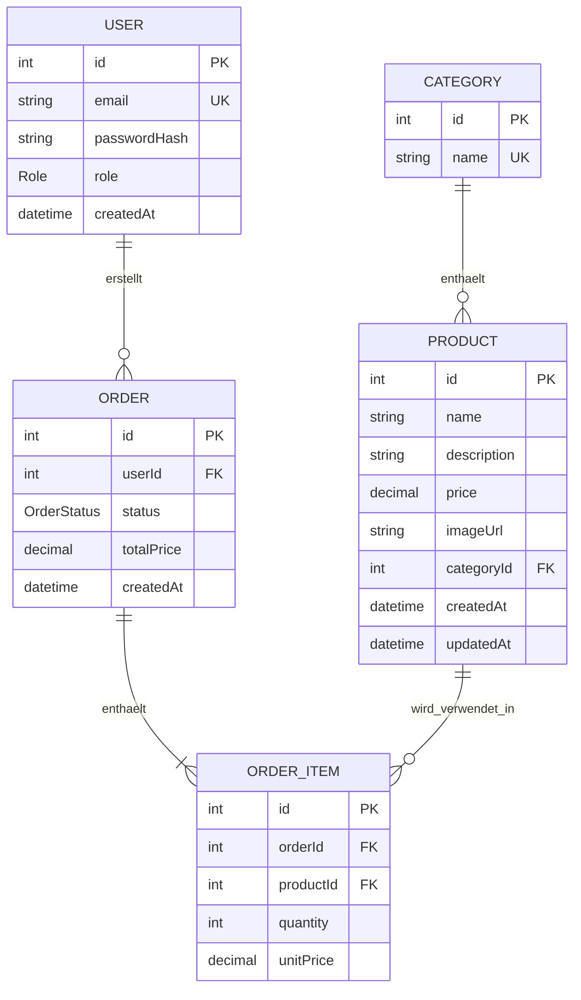

# Datenmodell – Mini E-Commerce

## User

| Feld         | Typ      | Eigenschaften                      |
| ------------ | -------- | ---------------------------------- |
| id           | Int      | Primary Key, automatisch generiert |
| email        | String   | eindeutig                          |
| passwordHash | String   | gehashtes Passwort                 |
| role         | Role     | Standardwert: USER                 |
| createdAt    | DateTime | automatisch gesetzt                |

Ein User kann mehrere Bestellungen erstellen.

## Category

| Feld | Typ    | Eigenschaften                      |
| ---- | ------ | ---------------------------------- |
| id   | Int    | Primary Key, automatisch generiert |
| name | String | eindeutig                          |

Eine Category kann mehrere Products enthalten.

Eine Category darf nicht gelöscht werden, solange sie noch Products enthält.

## Product

| Feld        | Typ      | Eigenschaften                      |
| ----------- | -------- | ---------------------------------- |
| id          | Int      | Primary Key, automatisch generiert |
| name        | String   | erforderlich                       |
| description | String   | erforderlich                       |
| price       | Decimal  | erforderlich, größer als 0         |
| imageUrl    | String   | optional                           |
| categoryId  | Int      | Foreign Key zu Category            |
| createdAt   | DateTime | automatisch gesetzt                |
| updatedAt   | DateTime | automatisch aktualisiert           |

Jedes Product gehört zu genau einer Category.

## Order

| Feld       | Typ         | Eigenschaften                      |
| ---------- | ----------- | ---------------------------------- |
| id         | Int         | Primary Key, automatisch generiert |
| userId     | Int         | Foreign Key zu User                |
| status     | OrderStatus | Standardwert: PENDING              |
| totalPrice | Decimal     | wird im Backend berechnet          |
| createdAt  | DateTime    | automatisch gesetzt                |

Jede Order gehört zu genau einem User und enthält mindestens ein OrderItem.

## OrderItem

| Feld      | Typ     | Eigenschaften                             |
| --------- | ------- | ----------------------------------------- |
| id        | Int     | Primary Key, automatisch generiert        |
| orderId   | Int     | Foreign Key zu Order                      |
| productId | Int     | Foreign Key zu Product                    |
| quantity  | Int     | ganze Zahl, größer als 0                  |
| unitPrice | Decimal | Produktpreis zum Zeitpunkt der Bestellung |

Ein OrderItem verbindet eine Order mit einem Product.

## Enums

### Role

- USER
- ADMIN
- SUPER_ADMIN

### OrderStatus

- PENDING
- PROCESSING
- COMPLETED
- CANCELLED

## Beziehungen

- User 1:N Order
- Category 1:N Product
- Order 1:N OrderItem
- Product 1:N OrderItem

## ERD

